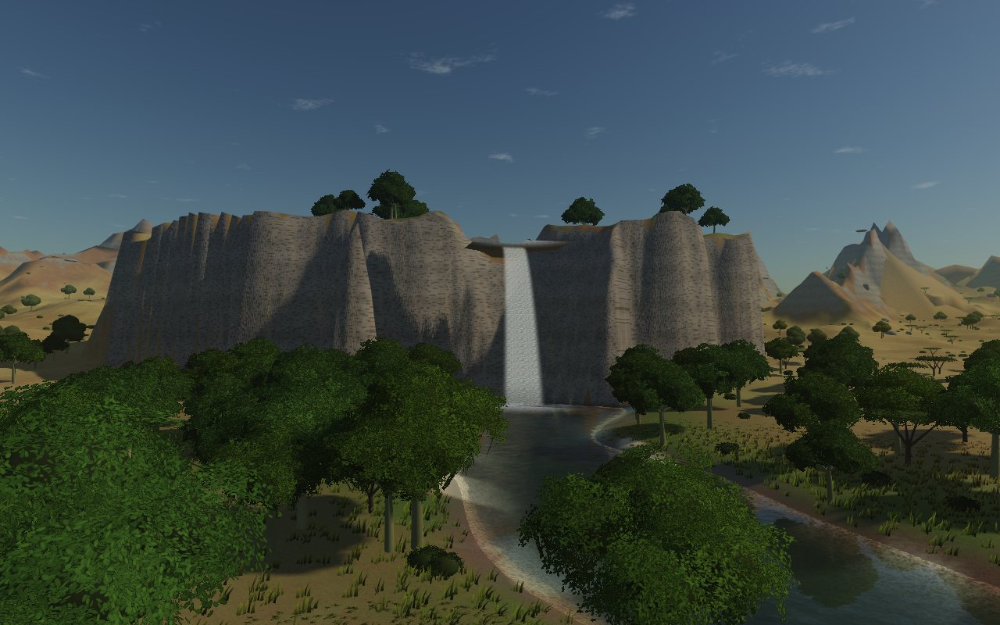
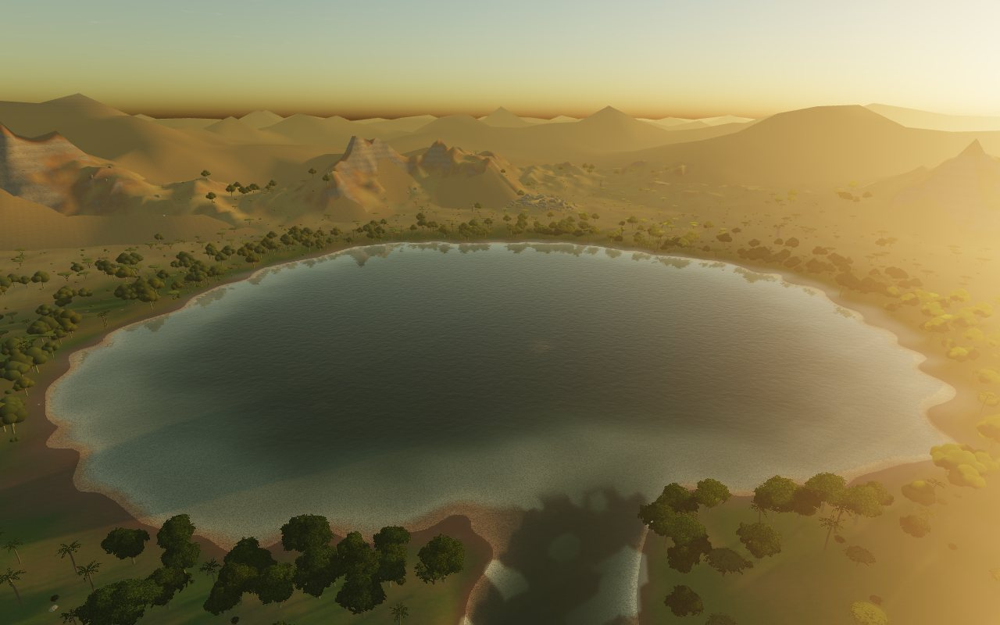
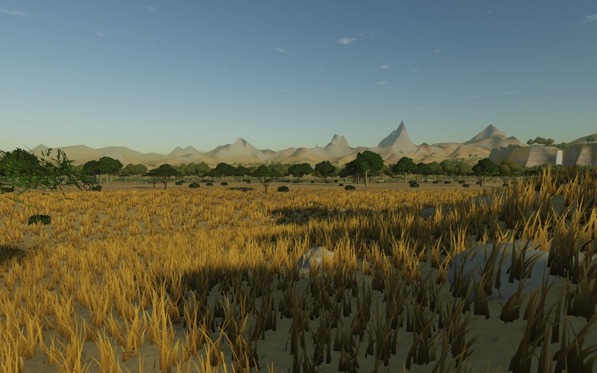

# LIFE ENGINE — 3D ecosystem simulator for Android tablets

An offline, scientifically grounded savanna ecosystem simulator with a custom OpenGL ES 3.0 PBR renderer.
No accounts, no API keys, no network access needed at runtime.

**Download:** the latest debug APK is attached to the [`debug-latest` release](../../releases/tag/debug-latest),
rebuilt and smoke-tested on a tablet emulator by GitHub Actions on every push to `main`.

## Status: Phase 1 of 7 complete

| Phase | Scope | Status |
|---|---|---|
| 1 | Android app, 3D savanna world, rendering, cameras, time of day, UI shell, saves | **Done** |
| 2 | Licensed rigged glTF animals + animation, follow camera | Next |
| 3 | Animal AI + ecological simulation (populations, food web, biomass, water) | Planned |
| 4 | Climate engine + weather effects (rain, lightning, seasons, drought) | Planned |
| 5 | Evolution (heritable traits, mutation, selection, drift) | Planned |
| 6 | Analytics dashboard + experiment lab | Planned |
| 7 | Performance pass + release APK | Planned |

### What Phase 1 contains
- **World**: procedural 3.1 × 3.1 km savanna basin (seeded, deterministic): ridged mountain ranges, a basalt
  plateau with a highland pool and waterfall, a meandering river, a lake with beaches, 5 waterholes with mud rims,
  granite kopjes, scree, a far-horizon mountain ring. ~10,000 placed plants and rocks: umbrella acacias,
  riverine fig/fever-tree galleries, doum palms, baobabs, shrubs, 4 rock types.
- **Rendering** (OpenGL ES 3.0): physically based single-scattering atmosphere (Rayleigh + Mie) driving sky,
  sun/moon light, ambient and fog; GGX specular; 3×3 PCF shadow maps; planar water reflections with Fresnel,
  normal-mapped waves, depth absorption, shoreline foam and caustics; volumetric-style height fog with sun
  in-scattering; procedural clouds with cloud shadows; stars and moon at night; wind-animated trees and grass;
  alpha-sharpened foliage cards; ACES tone mapping.
- **Performance**: chunked terrain with 4 LOD levels + skirts, frustum culling, GPU instancing for vegetation with
  2 LODs, GPU-placed two-layer grass in culled blocks, render scale via hardware scaler, 4 graphics presets with
  automatic selection from the GPU, thermal throttling response.
- **Cameras**: Explore (orbit), Free (drone), Wildlife (ground level), Aerial, Cinematic (7 scripted shots).
- **UI**: landscape-first dark tablet UI, 8 sections, live telemetry charts, climate controls, saves.
- **Time**: pause → 10,000×; lighting is held steady above 100× (no strobing day/night).

Phase 1 vegetation and terrain are procedural meshes generated on-device. Licensed animal models arrive in Phase 2.

## Build
See [docs/BUILD.md](docs/BUILD.md). Architecture and model assumptions: [docs/ARCHITECTURE.md](docs/ARCHITECTURE.md).

## Preview renders
Rendered headlessly from the same GLSL ES shaders and world generator that ship in the APK (Ultra preset):

| | |
|---|---|
|  |  |
|  |  |
